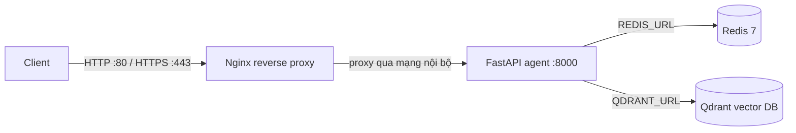

# MISSION_ANSWERS.md — Day 14

> Ghi câu trả lời và kết quả tự chạy tại đây. Không điền số liệu chưa đo.

## Part 1 — Localhost vs Production

### Anti-patterns tìm được trong `01-localhost-vs-production/develop/app.py`

1. API key và database URL được hardcode trong source; nếu dùng secret thật rồi push repo public thì có thể bị lộ.
2. Không có config management: `DEBUG = True` và `MAX_TOKENS = 500` được gán cố định, không đọc từ environment.
3. Dùng `print()` thay structured logging; dòng debug còn in cả API key ra log.
4. Không có endpoint `/health` hoặc `/ready` để nền tảng kiểm tra liveness/readiness.
5. Port bị cố định ở `8000`, không đọc biến `PORT` mà nền tảng cloud cung cấp.
6. Bind vào `localhost`, khiến dịch vụ không nhận kết nối từ bên ngoài container/máy.
7. `reload=True` luôn bật, không phù hợp cho cách chạy production.

### Kết quả thử develop

Chạy trong WSL2 bằng `python app.py`, sau đó gửi `curl -i -X POST "http://localhost:8000/ask?question=Hello"`. Server khởi động ở `http://localhost:8000`; request trả `HTTP/1.1 200 OK` cùng câu trả lời mock. Log cho thấy `[DEBUG] Got question: Hello`, `[DEBUG] Using key: sk-hardcoded-fake-key-never-do-this` và câu trả lời. Như vậy app chạy được local, nhưng log đã phơi bày giá trị key giả được hardcode. Khi dừng tiến trình thử nghiệm, Uvicorn ghi nhận shutdown và thoát.

### Bảng so sánh develop/production

| Khía cạnh | Develop | Production | Ý nghĩa khi deploy |
|---|---|---|---|
| Cấu hình/secret | Hardcode trong `app.py`; `DEBUG=True` | Cấu hình tập trung trong `config.py`, lấy từ environment | Thay đổi môi trường mà không sửa source; tránh commit secret thật |
| Logging | `print()`, có dòng in API key | Logger với format có cấu trúc; log request không chứa secret | Dễ tìm kiếm/thu thập log và giảm nguy cơ lộ thông tin |
| Host và port | `localhost:8000` cố định | Host/port lấy theo settings, hỗ trợ bind `0.0.0.0` và `PORT` | Container/cloud có thể nhận traffic qua cổng được nền tảng cấp |
| Kiểm tra trạng thái | Không có health endpoint | Có `GET /health`, `GET /ready` và `/metrics` | Nền tảng/load balancer kiểm tra trạng thái và readiness |
| Debug/reload | `reload=True` luôn bật | Reload chỉ bật khi cấu hình debug bật | Tránh chế độ phát triển chạy ngoài ý muốn trong production |
| Vòng đời/tắt app | Không có cleanup/lifecycle riêng | Có lifespan startup/shutdown và xử lý SIGTERM | Có điểm để khởi tạo/đóng tài nguyên khi app bắt đầu hoặc dừng |

## Part 2 — Docker

### Exercise 2.1 — Dockerfile cơ bản

1. Base image là `python:3.11` (bản đầy đủ).
2. Working directory trong container là `/app`.
3. `requirements.txt` được copy và cài trước source code để Docker cache layer cài dependency. Khi chỉ sửa code, các dependency không phải cài lại.
4. `CMD` đặt lệnh mặc định và có thể được thay khi chạy container. `ENTRYPOINT` xác định chương trình chính; tham số truyền khi chạy sẽ được đưa vào chương trình đó. Có thể kết hợp `ENTRYPOINT` và `CMD` để đặt tham số mặc định.

### Exercise 2.2 — Build và chạy image

Build từ gốc repo theo hướng dẫn K5:

```bash
docker build -f 02-docker/develop/Dockerfile -t my-agent:develop .
```

Kiểm tra kích thước bằng `docker image ls my-agent --format '{{.Repository}}:{{.Tag}} {{.Size}}'`:

| Image | Kích thước đo được |
|---|---:|
| `my-agent:develop` | 1.67 GB |
| `my-agent:advanced` | 240 MB |

Image advanced nhỏ hơn khoảng 86%. Container develop trả HTTP 200 cho `GET /health` và `POST /ask?question=What%20is%20Docker`. Container advanced trả HTTP 200 cho `GET /health` và `POST /ask` với JSON body.

### Exercise 2.3 — Multi-stage build

Stage 1 (`builder`) cài công cụ build và các thư viện Python. Stage 2 (`runtime`) bắt đầu từ `python:3.11-slim`, chỉ chép các package và file app cần để chạy. Image cuối không chứa compiler và các công cụ chỉ dùng khi build nên nhỏ hơn; kích thước đo được là 240 MB.

### Exercise 2.4 — Docker Compose

Khởi động stack bằng lệnh:

```bash
docker compose -p k5-day14-docker -f 02-docker/production/docker-compose.yml up -d --build
```

Có 4 service: agent, Redis, Qdrant và Nginx. Agent, Redis và Qdrant báo trạng thái healthy. Kiểm tra qua Nginx: `GET /health` trả HTTP 200; `POST /ask` với câu hỏi `Explain microservices` trả HTTP 200. Sau đó dừng stack và dọn volume bằng:

```bash
docker compose -p k5-day14-docker -f 02-docker/production/docker-compose.yml down -v
```



Nginx nhận request từ bên ngoài và chuyển tiếp đến agent trong mạng Compose. Agent dùng Redis cho cache/session và Qdrant cho tìm kiếm vector. `depends_on` cùng health check bảo đảm Redis và Qdrant sẵn sàng trước khi agent khởi động.

### Câu hỏi thảo luận

- `.dockerignore` nên loại `.env`/secret, `venv/`, `__pycache__/`, metadata Git và file sinh ra khi chạy. Việc này tránh gửi secret vào build context, giảm dữ liệu không cần thiết và tránh đưa môi trường riêng của máy vào image.
- Mount thư mục hoặc named volume vào container bằng `docker run -v thu_muc_may:/app/data ...`, hoặc khai báo `volumes:` trong Compose. Nếu container chỉ cần đọc dữ liệu, mount dạng chỉ đọc, ví dụ `:ro`.

## Part 3 — Cloud Deployment

### Exercise 3.3 — Pipeline Cloud Run

1. Cloud Build cài dependencies và chạy `pytest tests/`; bước build chỉ chạy sau khi test thành công.
2. Pipeline build Docker image có tag theo `$COMMIT_SHA` và `latest`, rồi push các tag lên Container Registry.
3. Sau khi push xong, pipeline deploy image theo commit lên Cloud Run ở `asia-southeast1`, cấu hình 1–10 instances, 512 MiB RAM, 1 CPU và timeout 60 giây.
4. `service.yaml` khai báo service tương đương dưới dạng cấu hình: concurrency 80, tài nguyên, biến môi trường và secrets lấy từ Secret Manager.
5. Service mở ingress công khai và cấu hình liveness `/health`, startup/readiness `/ready`; đây là mô tả cấu hình đọc từ file, chưa phải bằng chứng đã deploy.

Nền tảng deploy Part 6 và URL sau khi deploy: **chưa thực hiện**.

## Part 4 — API Security

### Kết quả Part 4 — JWT, rate limit và cost guard

Đã chạy bản `04-api-gateway/production` trong WSL2. Lấy JWT bằng tài khoản demo `student` (token không được lưu/dán vào báo cáo). Kết quả `curl -i` tương ứng:

| Trường hợp | Kết quả | Ý nghĩa |
|---|---|---|
| Gọi `POST /ask` không có Authorization | `HTTP 401 Unauthorized` — `Authentication required` | Endpoint yêu cầu JWT hợp lệ. |
| Gọi `POST /ask` với JWT hợp lệ và JSON `{"question":"what is docker?"}` | `HTTP 200 OK` — trả câu trả lời mock | Xác thực thành công, request được xử lý. |
| Gửi request hợp lệ liên tục với cùng user | Request thứ 11 trong cửa sổ 60 giây trả `HTTP 429 Too Many Requests`, `Retry-After: 59` giây | User tier bị giới hạn 10 request/phút; server yêu cầu chờ trước khi thử lại. |

**Cost guard:** trước khi gọi LLM, code kiểm tra chi phí đã ghi nhận trong ngày. Budget là `$1/ngày/user` và `$10/ngày toàn hệ thống`; cảnh báo khi user dùng từ 80% budget. Nếu vượt budget user, trả `402`; nếu vượt budget toàn cục, tạm ngưng với `503`. Sau khi gọi LLM, code cộng token/chi phí vào usage. Trong lab, LLM là mock và token count/giá chỉ mô phỏng; `CostGuard` lưu trong bộ nhớ nên mất khi restart và không chia sẻ giữa nhiều instance. Ngoài ra, response hiện gán `usage.total_cost_usd` vào trường `budget_remaining_usd`, nên con số trong trường đó thực tế là chi phí đã dùng, không phải ngân sách còn lại.

## Part 5 — Scaling & Reliability

### Kết quả scale 3 instance và `test_stateless.py`

Trong WSL2, tạo `.env.local` rỗng theo hướng dẫn và chạy `docker compose -p k5-day14-scaling up -d --build --scale agent=3`. `docker compose ps` cho thấy 3 container agent, Redis healthy và Nginx publish cổng 8080. `python3 test_stateless.py` hoàn tất 5 request trong cùng session; các request được phục vụ bởi 3 instance khác nhau (`instance-58fdf7`, `instance-8a134c`, `instance-777aea`). Endpoint history trả đủ 10 tin nhắn (5 user + 5 assistant), xác nhận session state được chia sẻ qua Redis khi request đi qua nhiều instance.

Sau khi lưu kết quả, đã chạy `docker compose -p k5-day14-scaling down`; các container và network của stack đã được dừng và gỡ bỏ.

## Part 6 — Final Project

TODO: dán kết quả check_production_ready.py sau khi chạy.

## AI log

- TODO: ghi câu hỏi đã hỏi AI, gợi ý nhận được, phần tự sửa và cách tự kiểm tra.
